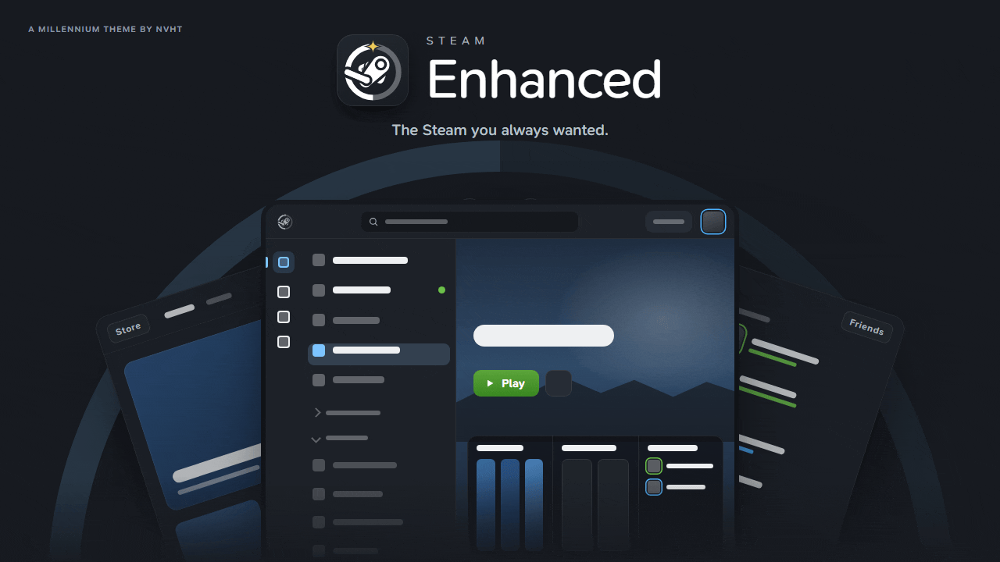
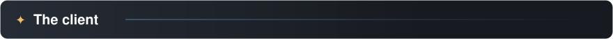
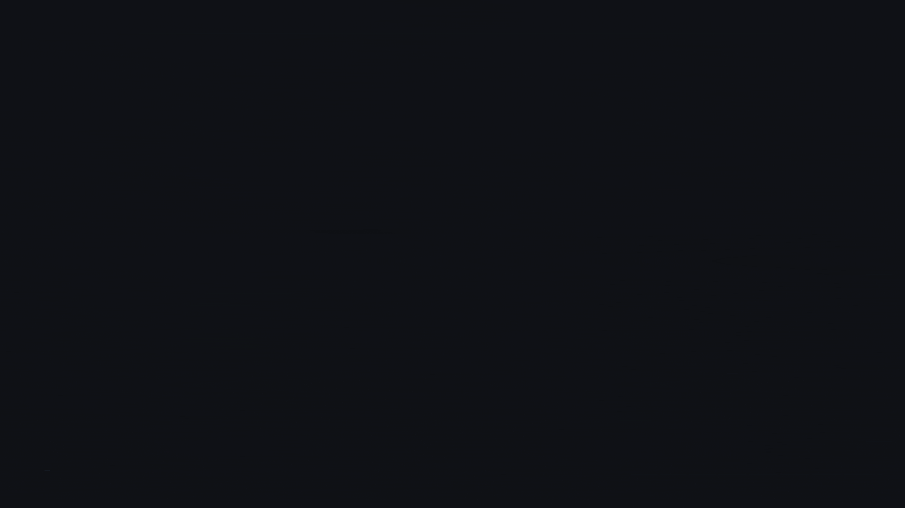
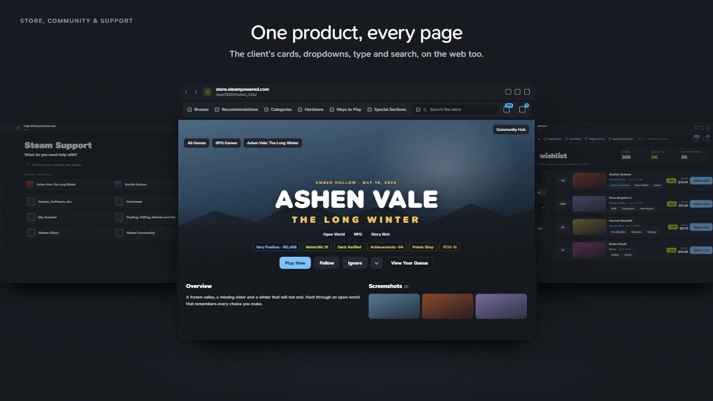
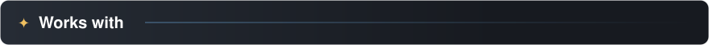
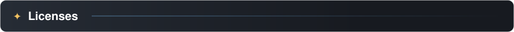

<p align="center">
  
</p>

<h1 align="center">Steam Enhanced</h1>

<p align="center">
  <b>The Steam you always wanted.</b><br>
  <sub>A redesign of the whole Steam desktop client, its in-game overlay and Steam's web pages, built for Millennium.</sub>
</p>

<p align="center">
  <a href="https://steambrew.app/theme/YS6sUrY4QsH0IS5Hexgj"></a>
  
  <a href="CHANGELOG.md"></a>
  <a href="https://steambrew.app/theme/YS6sUrY4QsH0IS5Hexgj"></a>
  <a href="LICENSE"></a>
</p>

<p align="center">
  <a href="https://steambrew.app/theme/YS6sUrY4QsH0IS5Hexgj"></a>
</p>

<p align="center">
  <a href="#the-client">The client</a>
  &nbsp;&nbsp;·&nbsp;&nbsp;
  <a href="#store-community-support">Store &amp; Community</a>
  &nbsp;&nbsp;·&nbsp;&nbsp;
  <a href="#install">Install</a>
  &nbsp;&nbsp;·&nbsp;&nbsp;
  <a href="#works-with">Works with</a>
  &nbsp;&nbsp;·&nbsp;&nbsp;
  <a href="#make-it-yours">Make it yours</a>
  &nbsp;&nbsp;·&nbsp;&nbsp;
  <a href="#licenses">Licenses</a>
</p>

<br>

Steam grew one feature at a time, and it shows. Steam Enhanced redraws it as one application, built around the thing you open it for: your games.

<table>
  <tr>
    <td width="33%" valign="top">
      <b>Your games first</b><br>
      <sub>Steam opens on a cinematic Home of your own games, not a storefront. Game pages, collections and downloads are built around them.</sub>
    </td>
    <td width="33%" valign="top">
      <b>One design, every window</b><br>
      <sub>The client, the overlay, Steam's Settings, the Store, Community and Support share the same cards, menus, buttons, type and colours.</sub>
    </td>
    <td width="33%" valign="top">
      <b>Nothing to give up</b><br>
      <sub>Steam runs as always underneath: your library, data and settings stay as they are, and every part of the theme can be turned back to Steam's own.</sub>
    </td>
  </tr>
</table>

<br>

<a name="the-client"></a>

<picture>
  <source media="(prefers-color-scheme: light)" srcset="assets/readme/h-client-light.svg">
  
</picture>

Every screen, from the moment Steam starts to the moment you quit a game.

<p align="center">
  
</p>

<table>
  <tr>
    <td width="33%" valign="top">
      <picture><source media="(prefers-color-scheme: light)" srcset="assets/readme/icon-home-light.svg"></picture><br>
      <h3>Library Home</h3>
      <sub>A stage for your recent games, favourites, a collection or your newest additions, with their art, trailer or screenshots behind. Below it, a board of panels you arrange. It always fits the window, and Steam's own Home is one switch away.</sub>
    </td>
    <td width="33%" valign="top">
      <picture><source media="(prefers-color-scheme: light)" srcset="assets/readme/icon-game-light.svg"></picture><br>
      <h3>Game pages</h3>
      <sub>A game at a glance, in two columns: HowLongToBeat bars, achievements in rarity tiers, and only the sections you want. Play turns to Stop while the game runs, and a finished game earns a gold <b>Mastered</b> banner.</sub>
    </td>
    <td width="33%" valign="top">
      <picture><source media="(prefers-color-scheme: light)" srcset="assets/readme/icon-collections-light.svg"></picture><br>
      <h3>Collections</h3>
      <sub>A big library sorted in seconds: grid or list, a summary banner per collection, and drag and drop that shows where each game will land.</sub>
    </td>
  </tr>
  <tr>
    <td valign="top">
      <picture><source media="(prefers-color-scheme: light)" srcset="assets/readme/icon-friends-light.svg"></picture><br>
      <h3>Friends</h3>
      <sub>Who is playing what, without opening a window: friends grouped by game, favourites first, in a dock that folds to a rail of Chats, Favorites, Playing, Online and Groups. Chats as bubbles, group chats in the dock, a bar for calls, and a card for any friend you point at.</sub>
    </td>
    <td valign="top">
      <picture><source media="(prefers-color-scheme: light)" srcset="assets/readme/icon-downloads-light.svg"></picture><br>
      <h3>Downloads</h3>
      <sub>Where a download stands, at a glance: the active one up front, live network and disk speed, and the Up Next queue. A card from the rail shows it from any page.</sub>
    </td>
    <td valign="top">
      <picture><source media="(prefers-color-scheme: light)" srcset="assets/readme/icon-overlay-light.svg"></picture><br>
      <h3>In-game overlay</h3>
      <sub>The same design in game: this session's and total play time beside the logo, a clock, a rail of views from Achievements to Notes, and a drawer that keeps the game in sight.</sub>
    </td>
  </tr>
  <tr>
    <td valign="top">
      <picture><source media="(prefers-color-scheme: light)" srcset="assets/readme/icon-startup-light.svg"></picture><br>
      <h3>Startup</h3>
      <sub>The theme's mark over a two-step network and sign-in bar, then a splash that welcomes you back with your last game while the Library loads, or draws the Store or Community page Steam starts on. Seven backgrounds, five spinners.</sub>
    </td>
    <td valign="top">
      <picture><source media="(prefers-color-scheme: light)" srcset="assets/readme/icon-settings-light.svg"></picture><br>
      <h3>Steam Settings</h3>
      <sub>Every page opens with a card that shows what its settings do: the In Game overlay as it will look, the Library at your UI scale, Steam Guard as a phone, your controllers lit as connected. Game Properties and the dialogs carry the game's art.</sub>
    </td>
    <td valign="top">
      <picture><source media="(prefers-color-scheme: light)" srcset="assets/readme/icon-toasts-light.svg"></picture><br>
      <h3>Toasts</h3>
      <sub>Notifications that inform without interrupting, on the desktop and in game: one card for every kind, achievements in their rarity tier, and a queue behind.</sub>
    </td>
  </tr>
</table>

<details>
<summary><b>Throughout the client</b> &nbsp;<sub>navigation, menus, tray, dialogs, shortcuts</sub></summary>
<br>

- **Navigation rail:** icons only, labels if you want them. Store, Library, Community and Profile open their page, or with a right-click a menu of their pages. Notifications, Announcements, Games, Downloads and Settings sit at the foot, above your avatar.
- **Title bar:** Library search with a Filters panel (a row per section and a Clear action), the Home switch, Friends &amp; Chat, and your avatar with an account menu that says what each row does.
- **Announcements and notifications:** Steam's news and your games' news in one feed, unread marked; notifications grouped by day.
- **Menus:** one design for every menu, the friends list's and the tray's included. A game's right-click menu has no submenus: Play, Favorite, Files, Hide and Uninstall sit in a bar, and Collections opens a searchable list to add, rename, delete and create.
- **Tray menu:** your status, the active download, recent games and Steam's pages as tiles.
- **Dialogs:** install, uninstall, backup, product activation, Mark as Private, Exit Game, collections, Group Settings, a friend's nickname and notifications, all rebuilt around the game's art or the friend's picture.
- **About Steam:** version and update status, build details that copy on click, the beta branch and Steam's latest patch notes.
- **System Information and Report:** specification tiles and section cards with a filter; IP and MAC addresses and hardware IDs stay blurred until selected.
- **Millennium Settings and Library Manager:** in the same design as the rest.
- **Keyboard shortcuts:** <kbd>Ctrl</kbd>+<kbd>`</kbd> Steam Settings, <kbd>Ctrl</kbd>+<kbd>Shift</kbd>+<kbd>`</kbd> Theme settings, <kbd>Ctrl</kbd>+<kbd>1</kbd> Millennium, <kbd>Ctrl</kbd>+<kbd>R</kbd> Reload UI, <kbd>Ctrl</kbd>+<kbd>Shift</kbd>+<kbd>R</kbd> Restart Steam.

</details>

<br>

<a name="store-community-support"></a>

<picture>
  <source media="(prefers-color-scheme: light)" srcset="assets/readme/h-web-light.svg">
  
</picture>

The redesign carries on past the client. Store, Community, Support and Checkout pages use the whole window and the client's cards, dropdowns, type and search, so browsing, buying and chatting feel like one product.

<p align="center">
  
</p>

<details>
<summary><b>Every page</b> &nbsp;<sub>Store, wishlist and checkout, account, Community, Support</sub></summary>
<br>

- **Store front:** a full-width hero with game tabs, event art, ranked lists beside a spotlight card, and a navigation bar with picture menus.
- **Game pages:** a title card over the hero art, one summary section with screenshots and features, the trailer as a card, and About This Game as a reading view.
- **Browse and search:** New &amp; Upcoming, Charts, Labs, DLC, Next Fest, the Steam Awards, Replay and sale pages. Search results as cards with release date, reviews and price in aligned columns.
- **Wishlist, cart and checkout:** a filter column from your top tags and cards with review summaries, then one cart and checkout flow with the total always in view and Purchase the only primary button.
- **Account and legal:** one settings page with a sidebar (purchase history, licenses, funds, Family View); agreements as documents with a table of contents.
- **Community:** profiles as cards over their own background, a three-column Activity feed, Hubs with a news reader and Guides, reviews, Discussions, an inventory grid with rarity highlights, and the Market. Formatted text looks the same in guides, posts, comments, reviews and profiles.
- **Support:** every help.steampowered.com page, from the help wizard to refunds and account recovery.

</details>

<br>

<a name="install"></a>

<picture>
  <source media="(prefers-color-scheme: light)" srcset="assets/readme/h-install-light.svg">
  
</picture>

> [!IMPORTANT]
> **You need** the [Steam](https://store.steampowered.com/about/) desktop client and [Millennium](https://steambrew.app), with theme JavaScript on.

1. In Steam, open **Steam → Millennium → Themes**.
2. Click **Install a theme** and enter `YS6sUrY4QsH0IS5Hexgj` (the ID on its [Steam Homebrew page](https://steambrew.app/theme/YS6sUrY4QsH0IS5Hexgj)).
3. Pick **Steam Enhanced** in the list.

Updates arrive the same way, through Millennium. What each version changed is in the [changelog](CHANGELOG.md).

> [!NOTE]
> **Sized to the window, not the screen.** The game list and Friends dock scale with the window: under 1400 px wide the dock folds to its rail, under 1000 px the game list hides. Either can still be opened by hand, and stays open.

<br>

<a name="works-with"></a>

<picture>
  <source media="(prefers-color-scheme: light)" srcset="assets/readme/h-works-with-light.svg">
  
</picture>

Popular Millennium plugins work with Steam Enhanced and take on its look.

| Plugin | What it adds | Where |
| --- | --- | --- |
| **[HLTB for Millennium](https://github.com/jcdoll/hltb-millennium-plugin)** | HowLongToBeat completion times | Game page |
| **[Extendium](https://github.com/BossSloth/Extendium)** | Chrome extensions in Steam's browser | Steam's browser |
| **[Size on Disk](https://github.com/k0d13/steam-size-on-disk)** | Disk space for each installed game | Game page · Settings |
| **[Player Count](https://github.com/swindlesmccoop/playercount-badge)** | Live player counts, in place of the theme's own | Game page |
| **[ProtonDB Library Badges](https://github.com/Yohlo/protondb-library-badges)** | ProtonDB ratings for Linux and Steam Deck | Game page · Library |
| **[Achievement Manager](https://github.com/madmaxgrey/AchievementManager)** | Unlocking and locking achievements | Game page · Own window |
| **[SteamGridDB](https://github.com/DevsNate/SteamGridDB-Millennium)** | Custom grids, heroes, logos and icons | Own window |
| **[Brew Hub](https://github.com/madmaxgrey/BrewHub)** | A catalogue of community themes and plugins | Millennium Settings |

<br>

<a name="make-it-yours"></a>

<picture>
  <source media="(prefers-color-scheme: light)" srcset="assets/readme/h-make-it-yours-light.svg">
  
</picture>

Every option lives in the theme's own settings window: **Theme settings** in the rail's Settings menu, the Steam menu or Millennium's Library Manager, or <kbd>Ctrl</kbd>+<kbd>Shift</kbd>+<kbd>`</kbd>. A tab per area, a search, and changes that apply at once, everywhere. Defaults are in bold.

<details>
<summary><b>Appearance and navigation</b> &nbsp;<sub>colours, font, corners, the rail</sub></summary>
<br>

| Setting | Options | What it does |
| --- | --- | --- |
| Colours | **Enhanced**, Graphite, Nebula, Mono, Tonal, Ember, Forest, Abyss, Rosewood, Slate, Midnight, Sand, Void, Custom | A preset for the client and web pages. Custom sets each colour, with a contrast mark on each. |
| Font | **SN Pro**, Xmind, Motiva Sans | The typeface everywhere, web pages too. |
| Corners | **Default**, Sharp, Round | How rounded corners are. |
| Glass effects | **On**, Off | The blur behind panels and bars. Off is lighter on slower PCs. |
| Contrast | **Standard**, High | High brightens secondary text and strengthens lines. |
| Animations | **Full**, Reduced | Reduced makes hovers and panels change at once; spinners still play. |
| Game art | **On**, Off | The game's art behind dialogs and Game Properties. |
| Menu windows | **Shadowed**, Solid | Solid drops the shadow and rounded corners of menus in their own window. The default on Linux, where those show black. |
| Menu hints | **On**, Off | The short line under each menu row. |
| Click opens | **Page**, Menu | What a click on a rail button opens; a right-click opens the other. |
| Menus open on hover | **Off**, On | Rail menus and the downloads card open when the pointer rests, after a short, default or long delay. |
| Rail buttons | all | Which buttons the rail shows. |
| Rail labels, Name under avatar, Game count | | Names under the rail's icons, your name under your avatar, the Library's game count in the title bar. |
| Keyboard shortcuts | **On**, Off | The theme's <kbd>Ctrl</kbd> shortcuts. |

</details>

<details>
<summary><b>Home</b> &nbsp;<sub>the stage, its games, Steam's Home</sub></summary>
<br>

The same settings open from a right-click on the title bar's Home switch.

| Setting | Options | What it does |
| --- | --- | --- |
| Home | **Stage**, Steam's | The theme's stage and panels, or Steam's own Home (What's New and the Add shelf row can each go). |
| Games, How many | **Recent**, Favorites, Collection, Added · 4, **6**, 8, 10 | What the stage features, and how many games it cycles through. |
| Details | all | Logo, developer, reviews, playing now, description, hours, achievements, last played. |
| Game picker | **Thumbnails**, Dots, Hidden | How you move between the stage's games. |
| Auto-switch | Off, 15 s, **9 s**, 5 s | How long each game stays before the next. |
| Background | **Zoom**, Parallax, Screenshots, Trailer, Still | Behind the featured game. |

Panels (Favorites, Collections, Recently added, Friend activity) are added, removed and reordered by dragging; each one's ⋯ menu sets its width and content. Without panels, the stage fills the window.

</details>

<details>
<summary><b>Startup</b> &nbsp;<sub>entrance, splash, background, spinner</sub></summary>
<br>

Windows keep the theme's background until they've loaded, so Steam's own look never flashes.

| Setting | Options | What it does |
| --- | --- | --- |
| Window entrance | **Splash**, Logo, Fade, None | Splash plays in the main window while the Library loads, then its art moves into Home; other windows use Logo. |
| Show splash, Splash art | | Every start, once a day or the first start only; Home's game, a random recent one or none. |
| Wait for Library | **Until ready**, At once | Hold the window until the Library settles (up to 3 s). |
| Startup background | **Aurora**, Library, Mosaic, Wall, Plain, Dots, Steam | Behind the sign-in and startup screens, animated or still. |
| Loading spinner | **Refined**, Comet, Elastic, Breathe, Classic | One spinner for every loading state, in the client, the splash and web pages. |

</details>

<details>
<summary><b>Library, Friends, Toasts, Overlay, Web pages</b></summary>
<br>

| Setting | Options | What it does |
| --- | --- | --- |
| Game page sections | all | Which sections a game's page shows. |
| Rarity tiers | **On**, Off | Achievements grouped from Legendary to Common, or the plain % of players. |
| Game icons, Game list width | | Each game's icon in the list; a fixed list, or one whose edge you drag (double-click resets). |
| Dock at startup | **As left**, Open, Folded | How the Friends dock starts. Its width is fixed or adjustable, like the game list's. |
| Chats open in | **Dock**, Window | Beside the dock, or in Steam's chat window. |
| Friend cards | **On**, Off | A friend's card when you point at them, after a short, default or long delay. |
| Profile backgrounds | **Video**, Still, Off | Friends' profile backgrounds in cards, dialogs and toasts. |
| Restyle toasts | **On**, Off | Steam's toasts in the theme's design, in game too if you want. |
| Toast style | **Stage**, Compact | Stage: one card at the bottom, top or corner, with game art or the achievement's icon and a queue behind. Compact: Steam's toasts restyled, at the centre or in the corner. Pause on hover and time on screen for both. |
| Restyle the overlay | **On**, Off | The in-game overlay in the theme's design. |
| Overlay | | Darkness, the view it opens on, the overview's panels, its views, the clock and play time. |
| Themed sites | all | Store, Community, Support and Checkout; the rest as Steam draws them. |
| Page width | **Default**, Comfortable, Edge to edge | How wide Store and Community pages run on a wide screen. |

</details>

<details>
<summary><b>Advanced</b> &nbsp;<sub><code>core/tokens.css</code></sub></summary>
<br>

Every colour, radius, shadow and timing is a token on `:root` in **`core/tokens.css`**; edits apply after a Steam restart, and a theme update writes over them. Two go further than their settings:

| Token | Default | Range |
| --- | --- | --- |
| `--se-overlay-dim` | `1.2` | `0.4`–`1.4`. Edges are black from 1; the game is fully hidden at 1.4. |
| `--se-col-w` | `clamp(280px, 210px + 5.46875vw, 420px)` | The width of the game list and Friends dock. Any CSS length. |

</details>

<br>

<a name="licenses"></a>

<picture>
  <source media="(prefers-color-scheme: light)" srcset="assets/readme/h-licenses-light.svg">
  
</picture>

Steam Enhanced is released under the [MIT License](LICENSE). It bundles these third-party parts, each under its own license, kept beside the files it covers:

| Component | Used for | License |
| --- | --- | --- |
| [SN Pro](https://github.com/supernotes/sn-pro) · © 2024 The SN Pro Project Authors | Default typeface | SIL Open Font License 1.1 · [`core/fonts/SNPro-OFL.txt`](core/fonts/SNPro-OFL.txt) |
| [Xmind](https://github.com/lamzhonghang/xmind) · © 2025 The Xmind Project Authors | Optional typeface | SIL Open Font License 1.1 · [`core/fonts/Xmind-OFL.txt`](core/fonts/Xmind-OFL.txt) |
| [hls.js](https://github.com/video-dev/hls.js) 1.6.15 · © 2017 Dailymotion | Store trailers and the Home stage's trailer background | Apache License 2.0 · [`web/store/vendor/hls.js-LICENSE`](web/store/vendor/hls.js-LICENSE) |

<details>
<summary><b>Project layout</b></summary>
<br>

```text
Steam-Enhanced/
├── skin.json     Millennium manifest: core.js and the client loader in every window
├── core/         Shared by client and web: tokens, colours, fonts, motion, icons, spinner, runtime and class map
├── client/       The client, a folder per area; shared/ for client-wide parts; loader.js maps windows to files
├── web/          Web pages: shared/ first, then store/, community/, help/ and checkout/, a folder per page
├── compat/       Plugin integrations, a folder per plugin
├── options/      A setting's stylesheets, a folder per settings tab
├── dev/          Element picker, profiler, startup preview, dialog launcher, toast preview, class map tools, checks, README and brand art
└── assets/       Logo, Millennium header and splash, web loop, README art (readme/)
```

</details>

<br>

---

<p align="center">
  <br>
  Made by <b>NVHT</b><br>
  <sub>Released under the <a href="LICENSE">MIT License</a>. Steam and the Steam logo are trademarks of Valve Corporation; Steam Enhanced is an independent project, not affiliated with or endorsed by Valve.</sub>
</p>
