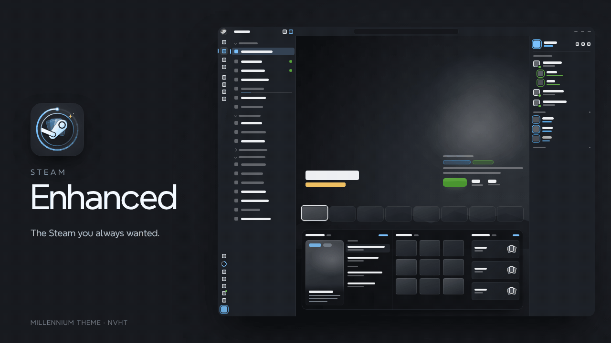

<p align="center">
  
</p>

<h1 align="center">Steam Enhanced</h1>

<p align="center">
  <b>The Steam you always wanted.</b><br>
  <sub>A Millennium theme that imagines what the Steam desktop client should look like.</sub>
</p>

<p align="center">
  
  <a href="https://github.com/NVHT/Steam-Enhanced/releases/latest"></a>
  <a href="LICENSE"></a>
</p>

<p align="center">
  <a href="#-install">Install</a>
  &nbsp;&nbsp;·&nbsp;&nbsp;
  <a href="#-the-client">The client</a>
  &nbsp;&nbsp;·&nbsp;&nbsp;
  <a href="#-store-community--support">Store &amp; Community</a>
  &nbsp;&nbsp;·&nbsp;&nbsp;
  <a href="#-make-it-yours">Make it yours</a>
  &nbsp;&nbsp;·&nbsp;&nbsp;
  <a href="#-licenses">Licenses</a>
</p>

<br>

Steam Enhanced rebuilds the Steam client around your library: a navigation rail, a cinematic Home stage, two-column game pages, a Friends dock that stays in reach and an overlay that matches. The Store, Community and Support pages follow in the same look.

> [!NOTE]
> Steam still runs underneath. Your library, data and settings behave exactly as Steam intends.

<br>

## ✦ Install

> [!IMPORTANT]
> **Requires** the [Steam](https://store.steampowered.com/about/) desktop client and [Millennium](https://steambrew.app), with theme JavaScript on.

1. Download the [latest release](https://github.com/NVHT/Steam-Enhanced/releases/latest).
2. Exit Steam from **Steam → Exit**.
3. Extract the `Steam-Enhanced` folder into `<Steam>/millennium/themes/`, so you end up with `themes/Steam-Enhanced/skin.json`.
4. Start Steam, go to **Millennium → Themes** and select **Steam Enhanced**.

> [!TIP]
> **Updating?** With Steam closed, delete the old `Steam-Enhanced` folder before extracting. Merging leaves stale files behind.

### Optional plugins

| Plugin | What it adds | Shows up in |
| --- | --- | --- |
| **[HLTB for Millennium](https://github.com/jcdoll/hltb-millennium-plugin)**<br><sub><code>jcdoll/hltb-millennium-plugin</code></sub> | HowLongToBeat completion times for each game | Game page |
| **[Extendium](https://github.com/BossSloth/Extendium)**<br><sub><code>BossSloth/Extendium</code></sub> | Chrome extensions inside Steam's browser | Steam's browser |
| **[Size on Disk](https://github.com/k0d13/steam-size-on-disk)**<br><sub><code>k0d13/steam-size-on-disk</code></sub> | How much disk space each installed game takes | Game page · Settings |
| **[Player Count](https://github.com/swindlesmccoop/playercount-badge)**<br><sub><code>swindlesmccoop/playercount-badge</code></sub> | Live player counts, replacing the theme's own | Game page |
| **[ProtonDB Library Badges](https://github.com/Yohlo/protondb-library-badges)**<br><sub><code>Yohlo/protondb-library-badges</code></sub> | ProtonDB compatibility tiers for Linux and Steam Deck | Game page · Library |
| **[Achievement Manager](https://github.com/madmaxgrey/AchievementManager)**<br><sub><code>madmaxgrey/AchievementManager</code></sub> | Unlock and lock achievements | Game page · Its own window |
| **[SteamGridDB](https://github.com/DevsNate/SteamGridDB-Millennium)**<br><sub><code>DevsNate/SteamGridDB-Millennium</code></sub> | Custom grids, heroes, logos and icons from SteamGridDB | Its own window |

> [!NOTE]
> Built for a Steam window at least **1920 px** wide, or **1600 px** with the Friends dock collapsed. That's your screen width divided by display scaling: 1920×1080 at 100%, 2560×1440 up to 125%, 4K up to 200%. Narrower windows work, but parts of Library Home may hide.

<br>

## ✦ The client

<table>
  <tr>
    <td width="33%" valign="top">
      <h3>Library Home</h3>
      <sub>A cinematic hero stage over your recent games, with a glass tray of news, favourites and collections.</sub>
    </td>
    <td width="33%" valign="top">
      <h3>Game pages</h3>
      <sub>Two independent columns, HowLongToBeat bars and achievement rarity tiers from Legendary to Common. Finish a game and the banner turns gold: <b>Mastered</b>.</sub>
    </td>
    <td width="33%" valign="top">
      <h3>Collections</h3>
      <sub>One view for a single collection or all of them, grid or list, summary banners, and drag and drop that shows where things land.</sub>
    </td>
  </tr>
  <tr>
    <td valign="top">
      <h3>Friends</h3>
      <sub>A dock grouped by what friends are playing, collapsible to a slim rail. Click a friend and their Steam chat opens beside it.</sub>
    </td>
    <td valign="top">
      <h3>Downloads</h3>
      <sub>The current download up front, live network, peak and disk speed on a running graph, and Up Next underneath.</sub>
    </td>
    <td valign="top">
      <h3>In-game overlay</h3>
      <sub>Session and total playtime beside the game logo, a rail of tabs (Overview, Achievements, Friends, Remote Play, Notes, Controller, Browser, Settings) and a drawer for the open view.</sub>
    </td>
  </tr>
  <tr>
    <td valign="top">
      <h3>Startup</h3>
      <sub>A Network, Steam, Library step strip, seven startup backgrounds, and five loading spinner styles that apply everywhere: client, Store and Community.</sub>
    </td>
    <td valign="top">
      <h3>About Steam</h3>
      <sub>Version and live update status up front, copy-on-click build tiles, the beta branch one click away, and Steam's latest patch notes in the dialog.</sub>
    </td>
    <td valign="top">
      <h3>Toasts</h3>
      <sub>Notifications play on a small Home stage at the bottom centre, on the desktop and in game, with achievements in their rarity tier.</sub>
    </td>
  </tr>
</table>

**Everywhere else**

| Area | What changes |
| --- | --- |
| **Navigation** | An icon-only rail: Store, Library, Community and Profile open menus of their pages, the one you're on lit. At its foot, notifications, a Downloads card, Settings and your avatar with your account menu. A title bar with library search and Friends. |
| **Notifications** | Grouped by day, opened by hovering the bell. |
| **Address bar** | A toolbar with a pill address field above store and Community pages. |
| **Settings &amp; dialogs** | Steam Settings, App Properties, Millennium Settings, Library Manager, install, uninstall, backups and product activation. |
| **System Information &amp; Report** | Spec tiles and section cards with jump chips and a filter. IPs, MACs and hardware IDs stay blurred until clicked. |

<br>

## ✦ Store, Community &amp; Support

Every web page fills the window and shares the theme's cards, pills, glass chips and type, one search field (the client's) and one breadcrumb trail.

| Area | What changes |
| --- | --- |
| **Store front** | A cinema hero from Featured &amp; Recommended with game tabs and a glass info bar, ranked lists beside a spotlight card, and a capsule store bar with hover menus of art tiles. |
| **Game pages** | A title card over the hero art, one summary band with screenshots and features, the trailer as a card with a picker, and About This Game in a reader window. |
| **Browse** | New &amp; Upcoming, Charts, Labs, DLC, Next Fest (with a live countdown), Steam Awards and Replay, plus sale and event pages. |
| **Account** | One settings page with a sticky sidebar: Account details, Purchase History and Licenses with search and filters, Add Funds, Redeem, phone, country and Family View. |
| **Legal** | The Subscriber Agreement and Privacy Policy as documents with a contents sidebar and progress bar. |
| **Community** | Profiles as glass cards over their own background, a three-column Activity feed, Hubs, reviews with a verdict hero over the game's art, Discussions, formatted text (headings, quotes, code, tables, lists, spoilers) in one look across guides, posts, comments, reviews and profiles, a 5 × 5 inventory grid with rarity glows and a Community Market with a wallet hero, ranked listings and a game filter. |
| **Support** | Every help.steampowered.com page, from the wizard to refunds and account recovery. |
| **Search** | Results as cards with aligned date, review and price columns, one toolbar card for search and sort, and filters as folding cards with accent checkboxes. |
| **Wishlist** | Item cards with the rounded capsule, review facts and tag pills, the shared price chip beside Add to Cart, one toolbar card for search, sort and options, and active filters as chips. |
| **Checkout** | The cart and checkout as one flow: item cards, a sticky total, payment details and Steam Points as cards, and Purchase as the one primary button. |

<br>

## ✦ Make it yours

Everything below is in **Millennium → Themes → Steam Enhanced → Edit**, on the tab named in each section, plus the **Accent** colour, used for links, buttons and selections. Most settings apply as soon as you pick them; the **Web** tab needs a Steam restart.

<details>
<summary><b>Appearance</b> &nbsp;<sub>font, motion, glass, corners</sub></summary>
<br>

| Setting | Options | What it does |
| --- | --- | --- |
| Font | **SN Pro**, Xmind, Steam (Motiva Sans) | The typeface everywhere: client, Store, Community, Support and Checkout. SN Pro and Xmind are bundled variable fonts (SIL OFL, licences in `core/fonts/`). |
| Animations | **Full**, Reduced | Reduced: hovers, presses and panels change at once instead of moving. Spinners and the window entrance still play. |
| Glass effects | **On**, Off | Off drops the frosted blur everywhere and makes see-through surfaces solid. Lighter on slower PCs. |
| Corners | **Default**, Sharp, Round | How rounded every corner is. |

</details>

<details>
<summary><b>Startup</b> &nbsp;<sub>entrance, background, spinner</sub></summary>
<br>

Windows stay on the theme background until they've loaded (the main window until the Library has finished building), so Steam's own look never flashes.

| Window entrance | How a window appears once loaded |
| --- | --- |
| **Splash** | The main window plays the Steam Enhanced splash (the wireframe Library and a card with a Library bar) while the Library builds. The bar reaches *Ready* in gold just as the Library appears. Other windows use Logo. |
| Logo | The Steam Enhanced mark breathes while the window loads, then grows and dissolves into it. |
| Fade | The window fades in. |
| None | The window appears at once. |

| Startup background | Behind the sign-in and startup screens |
| --- | --- |
| **Library** | A wireframe outline of the themed Library window. |
| Hero | Crossfading hero art from your 8 most recently played games. |
| Mosaic | A breathing 2:3 tile grid over Steam's login capsule wall. |
| Wall | Steam's login capsule wall, blurred and dimmed. |
| Plain | The theme background with a soft radial glow. |
| Dots | A fading dot matrix. |
| Steam | Steam's own login background. |

| Loading spinner | One spinner for every loader: client, Splash entrance, Store, Community and Support |
| --- | --- |
| **Refined** | A wider arc with a rounded, lit head on a thin track, turning with a slight ease. |
| Comet | A short tail led by a bright dot, around a gently floating Steam Enhanced mark. |
| Elastic | A solid arc that stretches ahead and catches up. |
| Breathe | Refined, with the mark breathing and a soft halo. |
| Classic | A fading tail with a flat head. |

</details>

<details>
<summary><b>Library</b> &nbsp;<sub>Home stage, game list</sub></summary>
<br>

| Setting | Options | What it does |
| --- | --- | --- |
| Library Home stage | **yes**, no | no restores Steam's Library Home (handy for editing shelves). |
| Home stage cycling | **Default** (9 s), Slow (15 s), Fast (5 s), Off | How often the stage moves to the next recent game. |
| Home stage tray | **On**, Off | What's New, Favorites and Collections under the stage. Off: the stage alone fills the window. |
| Home stage height | **Default**, Short, Tall | How much of the window the stage takes; the tray gets the rest. |
| Home stage strip | **On**, Off | The row of recent-game cards on the stage. Off hides it; the stage still cycles. |
| Home stage details | **Full**, Compact, Play only, Hidden | The panel beside the logo. Compact drops the description, Play only keeps the button, Hidden leaves the logo over the art. |
| Game list width | **Fixed**, Adjustable | Fixed keeps one width with no divider. Adjustable: drag the list's right edge, or focus it and use the arrow keys; double-click resets. |

</details>

<details>
<summary><b>Friends</b> &nbsp;<sub>dock width</sub></summary>
<br>

| Setting | Options | What it does |
| --- | --- | --- |
| Friends dock width | **Fixed**, Adjustable | The same as the game list, on the dock's left edge. Both columns start from one shared width. |

</details>

<details>
<summary><b>Overlay</b> &nbsp;<sub>restyle, darkness</sub></summary>
<br>

| Setting | Options | What it does |
| --- | --- | --- |
| In-game overlay restyle | **yes**, no | no restores Steam's in-game overlay. |
| Overlay darkness | **Default**, Light, Dark | The backdrop behind the overlay. Dark hides the game. The overlay's own Darkness slider overrides it. |

</details>

<details>
<summary><b>Toasts</b> &nbsp;<sub>notifications</sub></summary>
<br>

| Setting | Options | What it does |
| --- | --- | --- |
| Notification toasts | **yes**, no | no restores Steam's toasts, desktop and in game. |
| Toasts in game | **yes**, no | no keeps Steam's own in-game toasts. |
| Toast style | **Stage**, Compact | Stage plays toasts on a mini Home stage; Compact restyles Steam's toasts as cards. |
| Compact toast position | **Centre**, Corner | Compact toasts only: the centre of the screen edge, or Steam's corner. |

</details>

<details>
<summary><b>Web</b> &nbsp;<sub>Store, Community, Support, Checkout</sub></summary>
<br>

| Setting | Options | What it does |
| --- | --- | --- |
| Web pages | **Theme**, Steam's own | Steam's own leaves those pages exactly as Steam draws them, in Steam's font. The client stays themed. Restart Steam after changing it. |

</details>

<details>
<summary><b>Beyond the settings</b> &nbsp;<sub><code>core/tokens.css</code></sub></summary>
<br>

Every colour, radius, elevation and feature switch lives on `:root` in **`core/tokens.css`**. Change a value and restart Steam. A few take finer values than their setting offers:

| Token | Default | Range |
| --- | --- | --- |
| `--se-home-stage-cycle` | `9` | Any number of seconds; `0` stops cycling. |
| `--se-home-stage-tray` | `30` | The tray's share of the window, `0`–`70` (%). |
| `--se-overlay-dim` | `1.2` | `0.4`–`1.4`: edges are black from 1, the whole game is hidden at 1.4. |
| `--se-col-w` | `350px` | The default width of the game list and the Friends dock. |

</details>

<br>

## ✦ Licenses

Steam Enhanced is released under the [MIT License](LICENSE). It bundles a few third-party pieces, each under its own license, kept beside the files it covers:

| Component | Used for | License |
| --- | --- | --- |
| [SN Pro](https://github.com/supernotes/sn-pro) · © 2024 The SN Pro Project Authors | Default typeface | SIL Open Font License 1.1 · [`core/fonts/SNPro-OFL.txt`](core/fonts/SNPro-OFL.txt) |
| [Xmind](https://github.com/lamzhonghang/xmind) · © 2025 The Xmind Project Authors | Optional typeface | SIL Open Font License 1.1 · [`core/fonts/Xmind-OFL.txt`](core/fonts/Xmind-OFL.txt) |
| [hls.js](https://github.com/video-dev/hls.js) 1.6.15 · © 2017 Dailymotion | Store trailer playback | Apache License 2.0 · [`web/store/vendor/hls.js-LICENSE`](web/store/vendor/hls.js-LICENSE) |

The fonts stay under the OFL and the player under Apache 2.0; the MIT License covers the rest of the theme. Steam and the Steam logo are trademarks of Valve Corporation; Steam Enhanced is an unofficial theme and is not affiliated with Valve.

<br>

## ✦ Project layout

```text
Steam-Enhanced/
├── skin.json     Millennium manifest: core.js and the client loader, in every window (the loader adds the runtime)
├── core/         Shared by client and web: web boot (core.js), runtime and class map, tokens and icons, font, motion, level badges, scrollbars, spinner, emoticon picker
├── client/       Client features, one folder per area; shared/ for the client-only parts; loader.js maps windows to files
├── web/          The web sites: shared/ (site loader, runtime, base styles, search field, dropdown), then store/,
│                 community/, help/ and checkout/, each a config (loader.js) and one folder per page
├── compat/       Plugin integrations (HowLongToBeat, Extendium, Size on Disk, Player Count, ProtonDB, Achievement Manager, SteamGridDB)
├── options/      Setting overrides that Millennium applies when you pick them, one folder per settings tab
├── dev/          Element inspector (Ctrl+Shift+E), classmap.py, steamclasses.py, storeclasses.py, colors.py, css-check.py, spinner_svg.py
└── assets/       Logos, Millennium header and splash
```

<br>

---

<p align="center">
  <br>
  Made by <b>NVHT</b><br>
  <sub>Released under the <a href="LICENSE">MIT License</a>. Steam Enhanced is an unofficial theme and is not affiliated with Valve.</sub>
</p>
