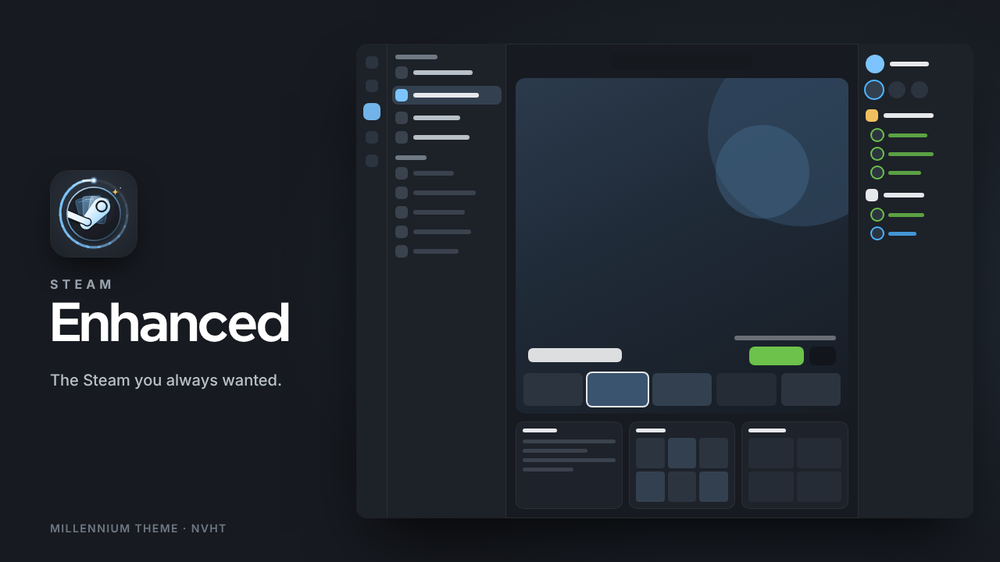
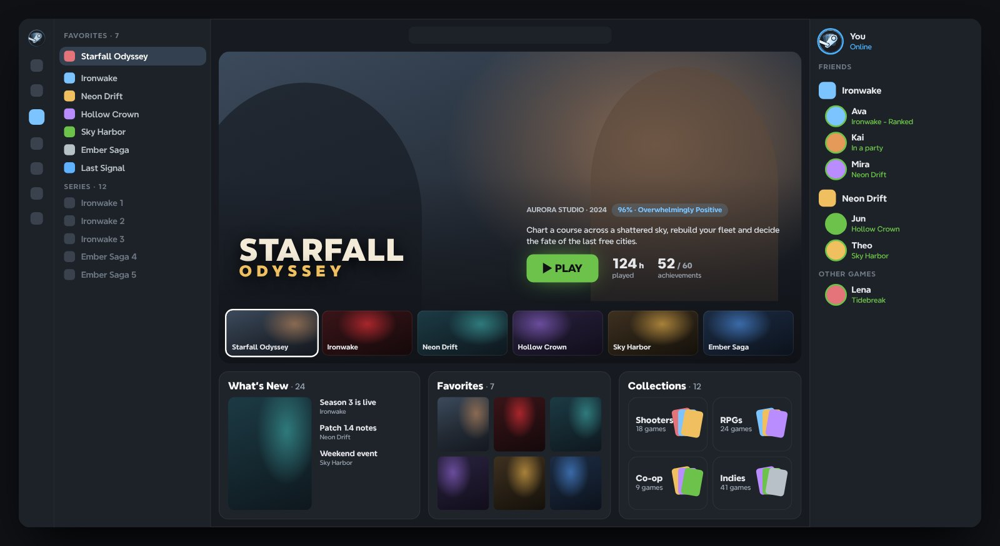
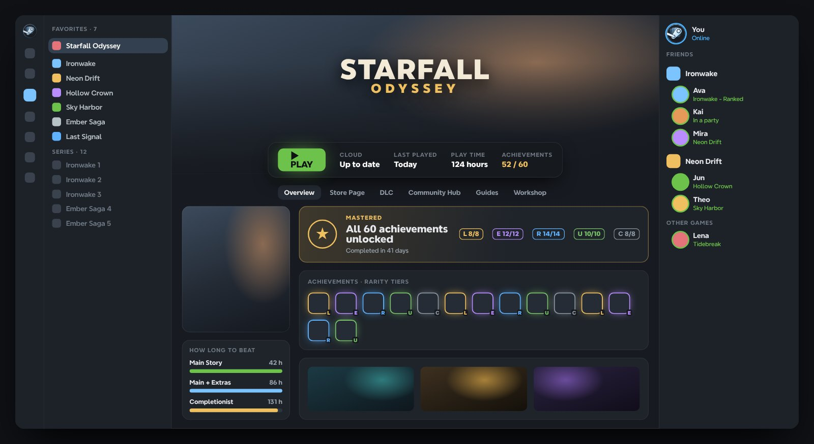
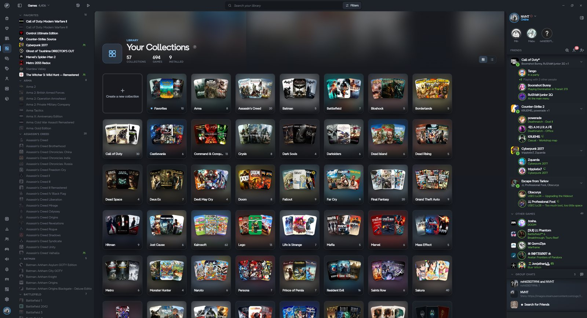
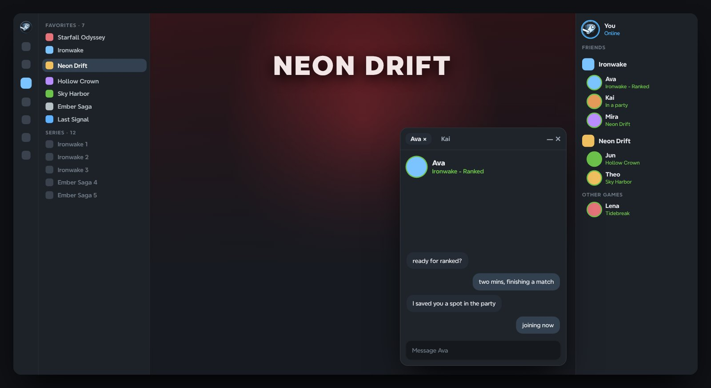
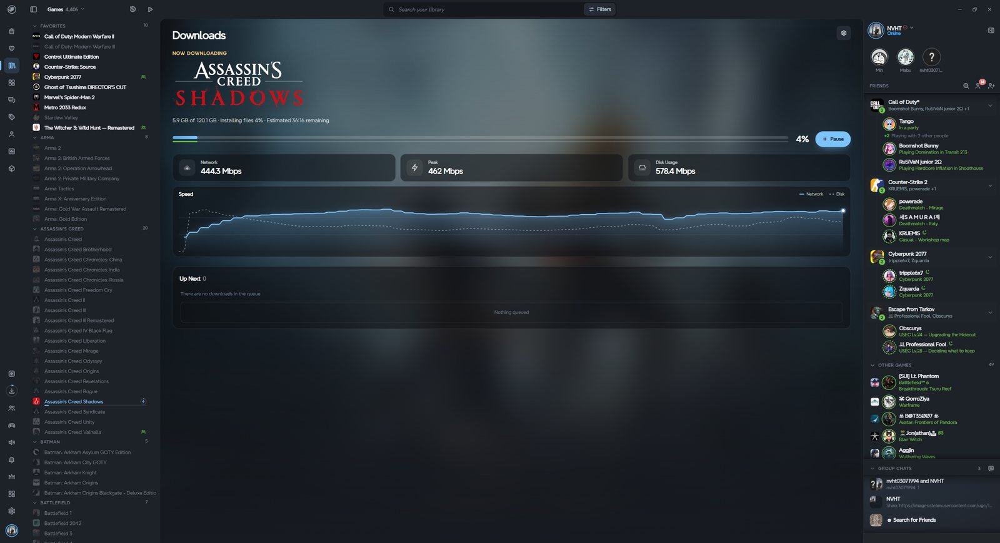
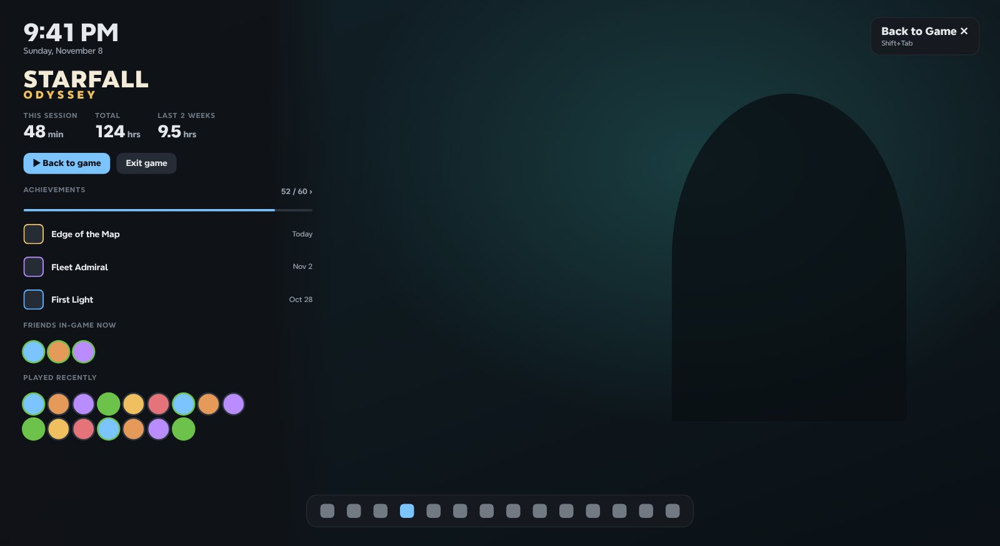
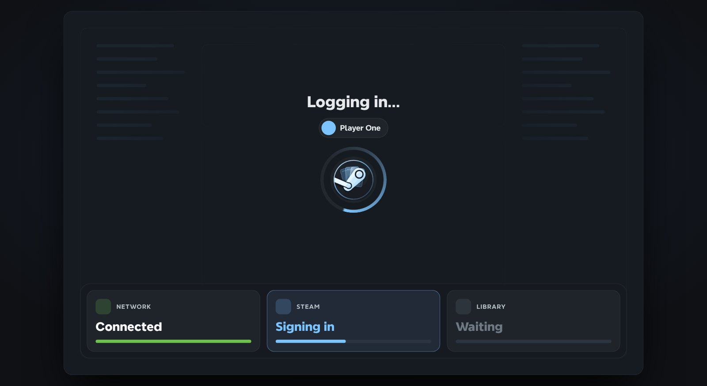
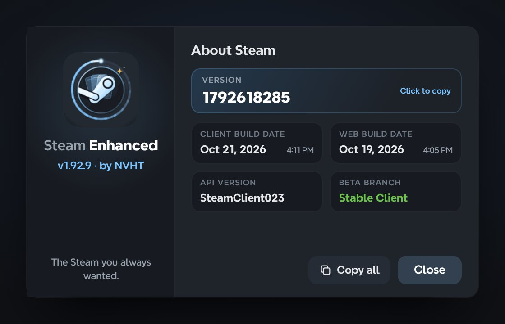

<p align="center">
  
</p>

<h1 align="center">Steam Enhanced</h1>

<p align="center">
  <strong>The Steam you always wanted.</strong><br>
  A Millennium theme for the Steam desktop client by <strong>NVHT</strong>.
</p>

<p align="center">
  
  
  
</p>

<p align="center">
  <a href="#highlights">Highlights</a> ·
  <a href="#install">Install</a> ·
  <a href="#make-it-yours">Make it yours</a> ·
  <a href="#troubleshooting">Troubleshooting</a>
</p>

---

Steam Enhanced rebuilds the Steam client from the Library out: a navigation rail, a cinematic Home stage, two-column game pages with HowLongToBeat and achievement rarity, a Friends dock that never leaves the window, and a restyled in-game overlay. Steam's own interface still runs underneath, with its state, data and behaviour untouched, so everything keeps working the way Steam intends. It just looks and feels the way it always should have.

> Scenes are illustrated with placeholder games and friends.

## Highlights

<table>
<tr>
<td width="58%"></td>
<td>
<h3>A Library that feels like home</h3>
<ul>
<li><b>Hero Home stage.</b> Your recently played games fill the screen with full-bleed art, the game's logo, its rating and your playtime.</li>
<li><b>Glass tray</b> for What's New, Favorites and Collections, always one glance away.</li>
<li><b>Recent games strip</b> to jump between what you're playing.</li>
</ul>
</td>
</tr>
<tr>
<td>
<h3>Game pages worth opening</h3>
<ul>
<li><b>Two independent columns</b> with full-width achievement rows, complete DLC grids, friend activity and media carousels.</li>
<li><b>HowLongToBeat built in.</b> Main Story, Main + Extras and Completionist as progress bars (with the HLTB for Millennium plugin).</li>
<li><b>Achievement rarity tiers.</b> Legendary, Epic, Rare, Uncommon and Common by global unlock rate. Finish a game and the banner turns gold: <b>Mastered</b>.</li>
</ul>
</td>
<td width="58%"></td>
</tr>
<tr>
<td width="58%"></td>
<td>
<h3>Collections, done properly</h3>
<ul>
<li><b>One unified view</b> for a single collection and for All Collections.</li>
<li><b>Grid or list</b>, with summary banners for counts and installs.</li>
<li><b>Drag and drop that shows where things land.</b> A compact game chip follows the pointer and drop zones light up as cards.</li>
</ul>
</td>
</tr>
<tr>
<td>
<h3>Friends, always in reach</h3>
<ul>
<li><b>Friends dock</b> on the right, grouped by the game your friends are playing. Collapse it to a slim 60px rail.</li>
<li><b>Native chat flyouts.</b> Click a friend and their real Steam chat opens beside the dock, shared across Library, Store and Community.</li>
<li><b>Smarter header.</b> Left-click Friends to toggle the dock, right-click for Steam's standalone window.</li>
</ul>
</td>
<td width="58%"></td>
</tr>
<tr>
<td width="58%"></td>
<td>
<h3>Downloads you can actually read</h3>
<ul>
<li><b>Master-detail view</b> with the current download front and centre.</li>
<li><b>Live telemetry.</b> Network, peak and disk speed with a running graph.</li>
<li><b>Up Next</b> queue right underneath.</li>
</ul>
</td>
</tr>
<tr>
<td>
<h3>An in-game overlay that matches</h3>
<ul>
<li><b>Game card</b> in the corner: clock, the game's logo, playtime this session, in total and over two weeks, plus Back to Game and Exit.</li>
<li><b>Achievements and friends at a glance</b>, closest unlocks or latest ones, and friends in-game now or played recently.</li>
<li><b>One rounded toolbar</b> and theme chrome on every widget window. Steam's own layout stays exactly where Steam puts it.</li>
</ul>
</td>
<td width="58%"></td>
</tr>
<tr>
<td width="58%"></td>
<td>
<h3>Startup with a sense of progress</h3>
<ul>
<li><b>Step-by-step strip</b>: Network, Steam, Library, so you know what Steam is waiting on.</li>
<li><b>Seven startup backgrounds</b> and a family of loading spinners to pick from.</li>
<li><b>Steam Enhanced branding</b> on the startup screen, account chooser, sign-in, spinners and the Steam menu button.</li>
</ul>
</td>
</tr>
<tr>
<td>
<h3>About Steam, rebuilt</h3>
<ul>
<li><b>Brand panel</b> with the theme's logo and version beside Steam's details.</li>
<li><b>Click any tile to copy it</b>, or <b>Copy all</b> for a bug report in one click.</li>
<li>Values come straight from Steam, so they're always current and in your language.</li>
</ul>
</td>
<td width="58%"></td>
</tr>
</table>

### And everywhere else

- **Navigation rail** with a consolidated root menu, title-bar library search and header quick actions. Restart Steam and Reload UI sit right above Exit.
- **Stage toasts.** Steam's desktop notifications play at the bottom centre as a small Home stage: the game's hero art, the sweep spinner as the countdown, achievements in their rarity tier, and a strip for the ones waiting.
- **Notifications** grouped by day under a summary card, opened by hovering the bell. The account menu has profile actions, Do Not Disturb and Online Status.
- **Settings and dialogs**: Steam Settings, App Properties, the Millennium Settings popup and the Millennium Library Manager, all restyled.

## Install

| You need | Optional |
| --- | --- |
| The Steam desktop client and [Millennium](https://steambrew.app), with theme JavaScript enabled. | **HLTB for Millennium**, for completion times. Keep it enabled; its *Show in Library* option can be off, because Steam Enhanced reads its data directly. |

1. Exit Steam completely.
2. Extract the release into `<Steam>/steamui/skins/`, so the manifest sits at `<Steam>/steamui/skins/Steam-Enhanced/skin.json`.
3. Launch Steam, open **Millennium → Themes** and select **Steam Enhanced**.
4. Enable theme JavaScript and restart Steam.

> [!TIP]
> **Updating?** With Steam closed, remove (or back up) the old `Steam-Enhanced` folder before extracting the new release. Merging folders can leave stale scripts and stylesheets behind.

## Make it yours

Every colour, radius, elevation, control height and feature switch lives on `:root` in **`shared/tokens.css`**. Edit a value and restart Steam.

<details>
<summary><b>Startup background</b> · <code>--se-startup-background</code></summary>

| Value | Look |
| --- | --- |
| `library` *(default)* | A wireframe outline of the themed Library window. No cached art needed. |
| `hero` | Crossfading hero artwork from your 8 most recently played games. |
| `mosaic` | A breathing 2:3 tile grid over Steam's login capsule wall. |
| `wall` | Steam's login capsule wall, blurred and dimmed. |
| `plain` | The solid theme background with a soft radial glow. |
| `dots` | A fading dot matrix over the base background. |
| `steam` | Steam's own login background, untouched. |

</details>

<details>
<summary><b>Loading spinner</b> · <code>--se-spinner</code></summary>

| Value | Look |
| --- | --- |
| `sweep` *(default)* | A conic arc with a glowing lead dot around the Steam Enhanced mark. |
| `deck` | Three of your game covers shuffling front to back. |
| `flip` | A two-sided card flipping through recent game covers. |
| `stack` | Four game covers dropping onto a stack. |
| `ring` | A solid accent arc around the Steam Enhanced mark. |
| `steam` | Steam's own throbber, untouched. |

Spinners smaller than 40px fall back to `sweep`.

</details>

<details>
<summary><b>Home stage, overlay and toasts</b></summary>

| Token | Default | What it does |
| --- | --- | --- |
| `--se-home-stage` | `on` | `off` restores Steam's default Library Home (handy when adding or reordering shelves). |
| `--se-home-stage-cycle` | `9` | Seconds between hero transitions. `0` stops auto-cycling. |
| `--se-home-stage-tray` | `30` | Minimum share of the window height kept for the glass tray, in percent (0–70). |
| `--se-overlay` | `on` | `off` restores Steam's default in-game overlay look. |
| `--se-overlay-dim` | `0.9` | How dark the backdrop behind the overlay is (0–1). |
| `--se-toasts` | `on` | `off` restores Steam's own desktop notification toasts. |

</details>

## Troubleshooting

<details>
<summary><b>The theme is missing from Millennium</b></summary>

Check that `skin.json` sits at `steamui/skins/Steam-Enhanced/skin.json`.

</details>

<details>
<summary><b>Interactive features are missing</b></summary>

Turn on theme JavaScript in Millennium's settings, then restart Steam.

</details>

<details>
<summary><b>Something broke after a Steam update</b></summary>

Steam may have rotated its CSS module class names. Rehash them with:

```
python3 tools/classmap.py rehash <path-to-extracted-steamui> .
```

</details>

## What's inside

| Folder | Contents |
| --- | --- |
| `skin.json` | Millennium manifest and window match rules. |
| `shared/` | Core runtime (`SE`), design tokens, icon masks, scrollbars. |
| `features/` | Feature scripts and stylesheets, grouped by part of the client. |
| `compatibility/` | Standalone styles for web views (`webkit.css`). |
| `branding/` | Logo sources, the Millennium store header and splash, and these showcase images. |
| `tools/` | CSS class-name indexer and rehash utility (`classmap.py`), and the spinner image builder (`spinner_svg.py`). |

---

<p align="center">
  <br>
  Made by <strong>NVHT</strong><br>
  <sub>Steam Enhanced is an unofficial theme and is not affiliated with Valve.</sub>
</p>
