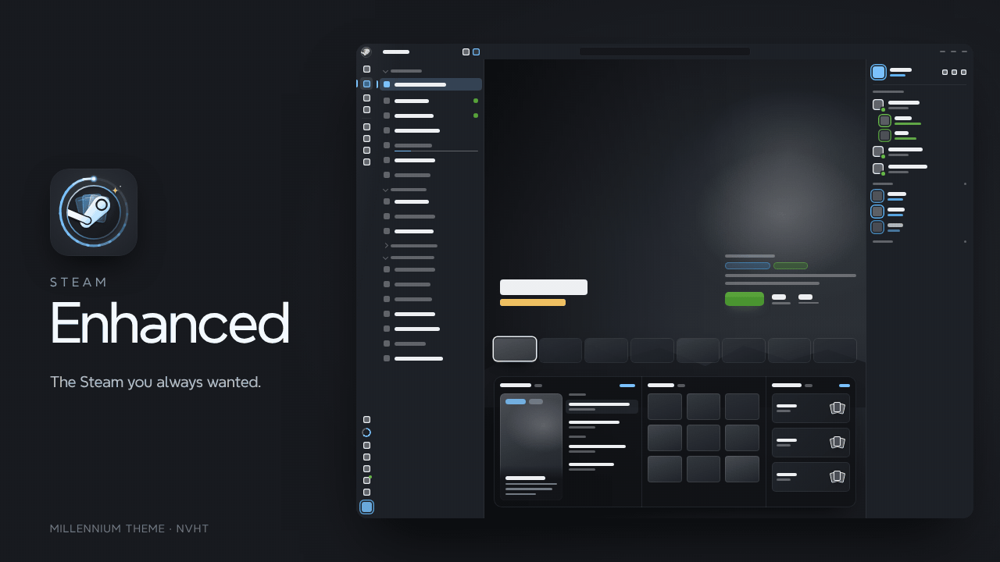

<p align="center">
  
</p>

<h1 align="center">Steam Enhanced</h1>

<p align="center">
  <b>The Steam you always wanted.</b><br>
  <sub>A Millennium theme that imagines what the Steam desktop client should look like.</sub>
</p>

<p align="center">
  
  <a href="https://github.com/NVHT/Steam-Enhanced/releases/latest"></a>
  <a href="LICENSE"></a>
</p>

<p align="center">
  <a href="#-install">Install</a>
  &nbsp;&nbsp;·&nbsp;&nbsp;
  <a href="#-the-client">The client</a>
  &nbsp;&nbsp;·&nbsp;&nbsp;
  <a href="#-store-community--support">Store &amp; Community</a>
  &nbsp;&nbsp;·&nbsp;&nbsp;
  <a href="#-make-it-yours">Make it yours</a>
  &nbsp;&nbsp;·&nbsp;&nbsp;
  <a href="#-troubleshooting">Troubleshooting</a>
</p>

<br>

Steam Enhanced rebuilds the Steam client around your library: a navigation rail, a cinematic Home stage, two-column game pages, a Friends dock that stays in reach and an overlay that matches. The store, Community and Support pages follow in the same look.

> [!NOTE]
> Steam still runs underneath. Your library, data and settings behave exactly as Steam intends.

<br>

## ✦ The client

<table>
  <tr>
    <td width="33%" valign="top">
      <h3>Library Home</h3>
      <sub>A cinematic hero stage over your recent games, with a glass tray of news, favourites and collections.</sub>
    </td>
    <td width="33%" valign="top">
      <h3>Game pages</h3>
      <sub>Two independent columns, HowLongToBeat bars and achievement rarity tiers from Legendary to Common. Finish a game and the banner turns gold: <b>Mastered</b>.</sub>
    </td>
    <td width="33%" valign="top">
      <h3>Collections</h3>
      <sub>One view for a single collection or all of them, grid or list, summary banners, and drag and drop that shows where things land.</sub>
    </td>
  </tr>
  <tr>
    <td valign="top">
      <h3>Friends</h3>
      <sub>A dock grouped by what friends are playing, collapsible to a slim rail. Click a friend and their Steam chat opens beside it.</sub>
    </td>
    <td valign="top">
      <h3>Downloads</h3>
      <sub>The current download up front, live network, peak and disk speed on a running graph, and Up Next underneath.</sub>
    </td>
    <td valign="top">
      <h3>In-game overlay</h3>
      <sub>Session and total playtime beside the game logo, a rail of tabs (Overview, Achievements, Friends, Remote Play, Notes, Controller, Browser, Settings) and a drawer for the open view.</sub>
    </td>
  </tr>
  <tr>
    <td valign="top">
      <h3>Startup</h3>
      <sub>A Network, Steam, Library step strip, seven startup backgrounds and a family of loading spinners.</sub>
    </td>
    <td valign="top">
      <h3>About Steam</h3>
      <sub>Version and live update status up front, copy-on-click build tiles, the beta branch one click away, and Steam's latest patch notes in the dialog.</sub>
    </td>
    <td valign="top">
      <h3>Toasts</h3>
      <sub>Notifications play on a small Home stage at the bottom centre, on the desktop and in game, with achievements in their rarity tier.</sub>
    </td>
  </tr>
</table>

**Everywhere else**

| | |
| --- | --- |
| **Navigation rail** | One root menu, title-bar library search, and Restart Steam / Reload UI above Exit. |
| **Notifications** | Grouped by day, opened by hovering the bell. |
| **Address bar** | A toolbar with a pill address field above store and Community pages. |
| **Settings &amp; dialogs** | Steam Settings, App Properties, Millennium Settings, Library Manager, install, uninstall, backups and product activation. |
| **System Information &amp; Report** | Spec tiles and section cards with jump chips and a filter. IPs, MACs and hardware IDs stay blurred until clicked. |

<br>

## ✦ Store, Community &amp; Support

Every web page fills the window and shares the theme's cards, pills, glass chips and type.

| | |
| --- | --- |
| **Store front** | A cinema hero from Featured &amp; Recommended with game tabs and a glass info bar, ranked lists beside a spotlight card, and a capsule store bar with hover menus of art tiles. |
| **Game pages** | A title card over the hero art, one summary band with screenshots and features, the trailer as a card with a picker, and About This Game in a reader window. |
| **Browse** | New &amp; Upcoming, Charts, Labs, DLC, Next Fest (with a live countdown), Steam Awards and Replay, plus sale and event pages. |
| **Account** | One settings page with a sticky sidebar: Account details, Purchase History and Licenses with search and filters, Add Funds, Redeem, phone, country and Family View. |
| **Legal** | The Subscriber Agreement and Privacy Policy as documents with a contents sidebar and progress bar. |
| **Community** | Profiles as glass cards over their own background, a three-column Activity feed, Hubs, Discussions, a 5 × 5 inventory grid with rarity glows and a Community Market with a wallet hero, ranked listings and a game filter. |
| **Support** | Every help.steampowered.com page, from the wizard to refunds and account recovery. |

<br>

## ✦ Install

| Required | Optional |
| --- | --- |
| The Steam desktop client and [Millennium](https://steambrew.app), with theme JavaScript on. | **HLTB for Millennium** for completion times. Keep it enabled; its *Show in Library* option can be off. |

1. Exit Steam completely.
2. Extract the release into `<Steam>/millennium/themes/`, so the manifest sits at `<Steam>/millennium/themes/Steam-Enhanced/skin.json`.
3. Launch Steam, open **Millennium → Themes** and pick **Steam Enhanced**.
4. Turn on theme JavaScript and restart Steam.

> [!IMPORTANT]
> Built for a Steam window at least **1920 px** wide, or **1600 px** with the Friends dock collapsed. That's your screen width divided by display scaling: 1920×1080 at 100%, 2560×1440 up to 125%, 4K up to 200%. Narrower windows work, but parts of Library Home may hide.

> [!TIP]
> **Updating?** With Steam closed, delete the old `Steam-Enhanced` folder before extracting. Merging leaves stale files behind.

<br>

## ✦ Make it yours

Every colour, radius, elevation and feature switch lives on `:root` in **`core/tokens.css`**. Change a value and restart Steam.

<details>
<summary><b>Startup background</b> &nbsp;<code>--se-startup-background</code></summary>
<br>

| Value | Look |
| --- | --- |
| `library` *(default)* | A wireframe outline of the themed Library window. |
| `hero` | Crossfading hero art from your 8 most recently played games. |
| `mosaic` | A breathing 2:3 tile grid over Steam's login capsule wall. |
| `wall` | Steam's login capsule wall, blurred and dimmed. |
| `plain` | The theme background with a soft radial glow. |
| `dots` | A fading dot matrix. |
| `steam` | Steam's own login background. |

</details>

<details>
<summary><b>Loading spinner</b> &nbsp;<code>--se-spinner</code></summary>
<br>

| Value | Look |
| --- | --- |
| `sweep` *(default)* | A conic arc with a glowing lead dot around the Steam Enhanced mark. |
| `deck` | Three of your game covers shuffling front to back. |
| `flip` | A two-sided card flipping through recent covers. |
| `stack` | Four covers dropping onto a stack. |
| `ring` | A solid accent arc around the mark. |
| `steam` | Steam's own throbber. |

Spinners under 40 px fall back to `sweep`.

</details>

<details>
<summary><b>Window entrance</b> &nbsp;<code>--se-entrance</code></summary>
<br>

Windows stay on the theme background until they've loaded (the main window until the Library has finished building), so Steam's own look never flashes. How they then appear:

| Value | Look |
| --- | --- |
| `splash` *(default)* | The main window plays the Steam Enhanced splash (the wireframe Library and the card with a Library bar) while the Library builds, picking up where the startup window leaves off. The bar reaches *Ready* in gold just as the finished Library appears. Other windows use `logo`. |
| `logo` | The Steam Enhanced mark breathes while the window loads, then grows and dissolves into it. |
| `fade` | The window fades in. |
| `none` | The window appears at once. |

</details>

<details>
<summary><b>Home stage, overlay and toasts</b></summary>
<br>

| Token | Default | What it does |
| --- | --- | --- |
| `--se-home-stage` | `on` | `off` restores Steam's Library Home (handy for editing shelves). |
| `--se-home-stage-cycle` | `9` | Seconds between hero transitions. `0` stops cycling. |
| `--se-home-stage-tray` | `30` | Minimum window height kept for the glass tray, in percent (0–70). |
| `--se-overlay` | `on` | `off` restores Steam's in-game overlay. |
| `--se-overlay-dim` | `1.2` | Backdrop darkness behind the overlay (0.4–1.4): edges are black from 1, the whole game is hidden at 1.4. The overlay's Darkness slider overrides it per user. |
| `--se-toasts` | `on` | `off` restores Steam's toasts, desktop and in game. |
| `--se-toasts-style` | `stage` | `stage` plays toasts on a mini Home stage; `compact` restyles Steam's toasts as cards. |
| `--se-toasts-position` | `center` | Compact toasts only: `center` or `corner`. |
| `--se-toasts-ingame` | `on` | `off` keeps Steam's own in-game toasts. |

</details>

<br>

## ✦ Troubleshooting

<details>
<summary><b>The theme is missing from Millennium</b></summary>
<br>

Check that `skin.json` sits at `millennium/themes/Steam-Enhanced/skin.json`.

</details>

<details>
<summary><b>Interactive features are missing</b></summary>
<br>

Turn on theme JavaScript in Millennium's settings, then restart Steam.

</details>

<details>
<summary><b>Something broke after a Steam update</b></summary>
<br>

Steam may have rotated its CSS module class names. Rehash them with:

```sh
python3 dev/classmap.py rehash <path-to-extracted-steamui> .
```

</details>

<br>

## ✦ Project layout

```text
Steam-Enhanced/
├── skin.json     Millennium manifest: core.js and the client loader, in every window
├── core/         Shared runtime (SE), tokens, font, icons, scrollbars, tooltips, plugin bridge
├── client/       Client features, one folder per area; loader.js sorts windows into groups and maps them to files
├── web/          Shared by the web sites: site loader, runtime (dom.js), base styles
├── store/        Store redesigns, one folder per page, loaded by store/loader.js
├── community/    Community redesigns, one folder per page plus shared/
├── help/         Steam Support pages
├── compat/       Plugin integrations (HowLongToBeat)
├── dev/          Element inspector (Ctrl+Shift+E), classmap.py, colors.py, css-check.py, spinner_svg.py
└── assets/       Logos, Millennium header and splash
```

<br>

---

<p align="center">
  <br>
  Made by <b>NVHT</b><br>
  <sub>Released under the <a href="LICENSE">MIT License</a>. Steam Enhanced is an unofficial theme and is not affiliated with Valve.</sub>
</p>
