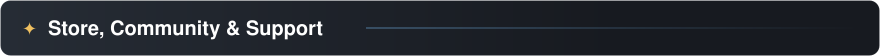
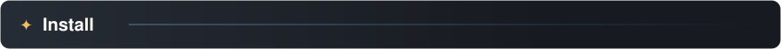

<p align="center">
  
</p>

<h1 align="center">Steam Enhanced</h1>

<p align="center">
  <b>The Steam you always wanted.</b><br>
  <sub>A complete redesign of the Steam desktop client, its in-game overlay and Steam's web pages, built for Millennium.</sub>
</p>

<p align="center">
  
  <a href="https://github.com/NVHT/Steam-Enhanced/releases/latest"></a>
  <a href="https://github.com/NVHT/Steam-Enhanced/releases"></a>
  <a href="LICENSE"></a>
</p>

<p align="center">
  <a href="https://github.com/NVHT/Steam-Enhanced/releases/latest"></a>
</p>

<p align="center">
  <a href="#the-client">The client</a>
  &nbsp;&nbsp;·&nbsp;&nbsp;
  <a href="#store-community-support">Store &amp; Community</a>
  &nbsp;&nbsp;·&nbsp;&nbsp;
  <a href="#install">Install</a>
  &nbsp;&nbsp;·&nbsp;&nbsp;
  <a href="#works-with">Works with</a>
  &nbsp;&nbsp;·&nbsp;&nbsp;
  <a href="#make-it-yours">Make it yours</a>
  &nbsp;&nbsp;·&nbsp;&nbsp;
  <a href="#licenses">Licenses</a>
</p>

<br>

Steam has grown one feature at a time, and it shows. Steam Enhanced brings it together as a single, modern application built around what matters most: your games.

<table>
  <tr>
    <td width="33%" valign="top">
      <b>Your library, front and centre</b><br>
      <sub>A cinematic Home you configure yourself, two-column game pages and collections you organise by dragging.</sub>
    </td>
    <td width="33%" valign="top">
      <b>One product, every window</b><br>
      <sub>The client, the overlay, the Store, Community and Support share one design system: the same cards, menus, buttons and type everywhere.</sub>
    </td>
    <td width="33%" valign="top">
      <b>Nothing to give up</b><br>
      <sub>Steam keeps running underneath. Your library, data and settings stay exactly as they are, and Steam's own look is one click away.</sub>
    </td>
  </tr>
</table>

<br>

<a name="the-client"></a>

<picture>
  <source media="(prefers-color-scheme: light)" srcset="assets/readme/h-client-light.svg">
  
</picture>

Every screen has been rethought, from the moment Steam starts to the moment you quit a game.

<table>
  <tr>
    <td width="33%" valign="top">
      <picture><source media="(prefers-color-scheme: light)" srcset="assets/readme/icon-home-light.svg"></picture><br>
      <h3>Library Home</h3>
      <sub>Open Steam to your games, not a storefront. A cinematic stage for recent games, favourites or a collection, above a board of panels you arrange. It always fits the window.</sub>
    </td>
    <td width="33%" valign="top">
      <picture><source media="(prefers-color-scheme: light)" srcset="assets/readme/icon-game-light.svg"></picture><br>
      <h3>Game pages</h3>
      <sub>Everything about a game at a glance: two columns, HowLongToBeat bars and achievement rarity tiers. Play becomes Stop while a game runs, and a completed game earns a gold <b>Mastered</b> banner.</sub>
    </td>
    <td width="33%" valign="top">
      <picture><source media="(prefers-color-scheme: light)" srcset="assets/readme/icon-collections-light.svg"></picture><br>
      <h3>Collections</h3>
      <sub>Organise a large library in seconds: grid or list, summary banners, and drag and drop that shows exactly where each game will land.</sub>
    </td>
  </tr>
  <tr>
    <td valign="top">
      <picture><source media="(prefers-color-scheme: light)" srcset="assets/readme/icon-friends-light.svg"></picture><br>
      <h3>Friends</h3>
      <sub>See who is playing what without opening a window. Friends are grouped by game, favourites first, and the dock folds into a compact rail of Chats, Favorites, Playing, Online and Groups.</sub>
    </td>
    <td valign="top">
      <picture><source media="(prefers-color-scheme: light)" srcset="assets/readme/icon-downloads-light.svg"></picture><br>
      <h3>Downloads</h3>
      <sub>Know exactly where a download stands: the active download up front, live network and disk speed, and the Up Next queue.</sub>
    </td>
    <td valign="top">
      <picture><source media="(prefers-color-scheme: light)" srcset="assets/readme/icon-overlay-light.svg"></picture><br>
      <h3>In-game overlay</h3>
      <sub>The same design in game: session and total playtime beside the logo, a tab rail from Achievements to Notes, and a drawer that keeps the game in view.</sub>
    </td>
  </tr>
  <tr>
    <td valign="top">
      <picture><source media="(prefers-color-scheme: light)" srcset="assets/readme/icon-startup-light.svg"></picture><br>
      <h3>Startup</h3>
      <sub>A polished first impression: a clear Network, Steam, Library progress strip, seven backgrounds and five spinner styles.</sub>
    </td>
    <td valign="top">
      <picture><source media="(prefers-color-scheme: light)" srcset="assets/readme/icon-about-light.svg"></picture><br>
      <h3>About Steam</h3>
      <sub>Version and update status at a glance, build details that copy on click, the beta branch one click away and Steam's latest patch notes.</sub>
    </td>
    <td valign="top">
      <picture><source media="(prefers-color-scheme: light)" srcset="assets/readme/icon-toasts-light.svg"></picture><br>
      <h3>Toasts</h3>
      <sub>Notifications that inform without interrupting, on the desktop and in game, with every achievement shown in its rarity tier.</sub>
    </td>
  </tr>
</table>

<details>
<summary><b>Throughout the client</b> &nbsp;<sub>navigation, menus, tray, settings, shortcuts</sub></summary>
<br>

- **Navigation:** an icon-only rail. Store, Library, Community and Profile open menus of their pages; a right-click opens the first page directly. Notifications, Announcements, Games, Downloads and Settings sit at the bottom.
- **Title bar:** Library search with a Filters panel (one row of filters per section, with a Clear action), the account avatar with status and an account menu that describes each entry, and Friends &amp; Chat.
- **Announcements and notifications:** Steam news and game news in a single feed with unread indicators; notifications grouped by day.
- **Menus:** a consistent design for every menu, including those of the friends list. The game context menu has no submenus: Play, Favorite, Files, Hide and Uninstall appear in a toolbar, and Collections opens a searchable list for adding, renaming, deleting and creating collections.
- **Tray menu:** account status, the active download, recent games and shortcuts to Steam's pages.
- **Settings and dialogs:** Steam Settings, Millennium Settings, Library Manager, and Game Properties with the game's artwork as a header. Install, uninstall, backup, product activation, Mark as Private, Exit Game and collection dialogs all display the game's artwork.
- **Keyboard shortcuts:** <kbd>Ctrl</kbd>+<kbd>`</kbd> Steam Settings, <kbd>Ctrl</kbd>+<kbd>1</kbd> Millennium, <kbd>Ctrl</kbd>+<kbd>R</kbd> reload the interface, <kbd>Ctrl</kbd>+<kbd>Shift</kbd>+<kbd>R</kbd> restart Steam.
- **System Information and Report:** specification tiles and section cards with quick navigation and a filter. IP addresses, MAC addresses and hardware IDs remain blurred until selected.

</details>

<br>

<a name="store-community-support"></a>

<picture>
  <source media="(prefers-color-scheme: light)" srcset="assets/readme/h-web-light.svg">
  
</picture>

The redesign does not stop at the client. Every Store, Community and Support page uses the full window and the same cards, dropdowns, typography and search as the client, so browsing, buying and chatting feel like one product.

<details>
<summary><b>Every page</b> &nbsp;<sub>Store, wishlist and checkout, account, Community, Support</sub></summary>
<br>

- **Store front:** a full-width hero with game tabs, event artwork, ranked lists beside a spotlight card, and a navigation bar with image-based menus.
- **Game pages:** a title card over the hero artwork, a single summary section with screenshots and features, the trailer as a card, and About This Game in a reading view.
- **Browse and search:** New &amp; Upcoming, Charts, Labs, DLC, Next Fest, the Steam Awards, Replay and sale pages. Search results appear as cards with aligned release date, review and price columns.
- **Wishlist, cart and checkout:** a filter column based on the account's top tags and item cards with review summaries, followed by a single cart and checkout flow with a persistent total and Purchase as the sole primary action.
- **Account and legal:** a single settings page with a persistent sidebar (purchase history, licenses, funds, Family View), and agreements presented as documents with a table of contents.
- **Community:** profiles as cards over their own background, a three-column Activity feed, Hubs with a news reader and Guides, reviews, Discussions, an inventory grid with rarity highlights, and the Market. Formatted text renders consistently in guides, posts, comments, reviews and profiles.
- **Support:** every help.steampowered.com page, from the help wizard to refunds and account recovery.

</details>

<br>

<a name="install"></a>

<picture>
  <source media="(prefers-color-scheme: light)" srcset="assets/readme/h-install-light.svg">
  
</picture>

> [!IMPORTANT]
> **Requirements:** the [Steam](https://store.steampowered.com/about/) desktop client and [Millennium](https://steambrew.app), with theme JavaScript enabled.

1. Download the [latest release](https://github.com/NVHT/Steam-Enhanced/releases/latest).
2. Close Steam from **Steam → Exit**.
3. Extract the `Steam-Enhanced` folder into `<Steam>/millennium/themes/`. The result should be `themes/Steam-Enhanced/skin.json`.
4. Start Steam, open **Millennium → Themes** and select **Steam Enhanced**.

> [!TIP]
> **Updating:** with Steam closed, delete the existing `Steam-Enhanced` folder before extracting the new release. Extracting over an older copy leaves obsolete files in place.

> [!NOTE]
> **Responsive layout.** The layout responds to the window size rather than the display. The game list and Friends dock scale with the window; below 1400 px the dock collapses to its rail, and below 1000 px the game list is hidden. Either can still be opened manually and stays open.

<br>

<a name="works-with"></a>

<picture>
  <source media="(prefers-color-scheme: light)" srcset="assets/readme/h-works-with-light.svg">
  
</picture>

Steam Enhanced works with the most popular Millennium plugins and styles them to look native.

| Plugin | Function | Location |
| --- | --- | --- |
| **[HLTB for Millennium](https://github.com/jcdoll/hltb-millennium-plugin)** | HowLongToBeat completion times | Game page |
| **[Extendium](https://github.com/BossSloth/Extendium)** | Chrome extensions in Steam's browser | Steam's browser |
| **[Size on Disk](https://github.com/k0d13/steam-size-on-disk)** | Disk usage for each installed game | Game page · Settings |
| **[Player Count](https://github.com/swindlesmccoop/playercount-badge)** | Live player counts, in place of the theme's own | Game page |
| **[ProtonDB Library Badges](https://github.com/Yohlo/protondb-library-badges)** | ProtonDB ratings for Linux and Steam Deck | Game page · Library |
| **[Achievement Manager](https://github.com/madmaxgrey/AchievementManager)** | Achievement unlocking and locking | Game page · Separate window |
| **[SteamGridDB](https://github.com/DevsNate/SteamGridDB-Millennium)** | Custom grids, heroes, logos and icons | Separate window |
| **[Brew Hub](https://github.com/madmaxgrey/BrewHub)** | A catalogue of community themes and plugins | Millennium Settings |

<br>

<a name="make-it-yours"></a>

<picture>
  <source media="(prefers-color-scheme: light)" srcset="assets/readme/h-make-it-yours-light.svg">
  
</picture>

Most options are under **Millennium → Themes → Steam Enhanced → Edit**, on the tab named in each section below, together with the **Accent** colour used for links, buttons and selections. Changes take effect immediately, except those on the **Web** tab, which require a Steam restart.

<details>
<summary><b>Library Home</b> &nbsp;<sub>its own menu</sub></summary>
<br>

The Home stage has its own menu, opened from its upper-right corner:

- **Home:** Steam Enhanced's Home or Steam's own.
- **Featured games:** recently played, Favorites A–Z, a collection or recently added, and the number shown.
- **On the stage:** which details are displayed, and whether games are navigated with thumbnails, dots or neither.
- **Cycling:** the interval before the stage advances to the next game.
- **Background:** a slow zoom, pointer-driven parallax, screenshots, the muted trailer or a still image.
- **Panels:** Favorites, Collections, Recently added and Friend activity, which can be added, removed and reordered by dragging. Without panels, the stage fills the window.

Each panel's ⋯ menu sets its width (one third, two thirds or the full board) and its content. Panels that do not fit continue on additional pages.

</details>

<details>
<summary><b>Appearance</b> &nbsp;<sub>font, motion, glass, corners</sub></summary>
<br>

| Setting | Options | Description |
| --- | --- | --- |
| Font | **SN Pro**, Xmind, Steam (Motiva Sans) | The typeface across the client, Store, Community, Support and Checkout. |
| Animations | **Full**, Reduced | Reduced makes hover, press and panel changes immediate. Spinners and the window entrance still animate. |
| Glass effects | **On**, Off | Off removes background blur and makes translucent surfaces opaque, which reduces load on slower hardware. |
| Corners | **Default**, Sharp, Round | The corner radius used throughout. |

</details>

<details>
<summary><b>Startup</b> &nbsp;<sub>entrance, background, spinner</sub></summary>
<br>

Windows keep the theme's background until they have finished loading, so Steam's default appearance is never briefly visible.

| Setting | Options | Description |
| --- | --- | --- |
| Window entrance | **Splash**, Logo, Fade, None | Splash runs in the main window while the Library loads and completes as it appears; other windows use Logo. |
| Startup background | **Library**, Hero, Mosaic, Wall, Plain, Dots, Steam | The background of the sign-in and startup screens: a wireframe of the Library, recent games' hero artwork, Steam's capsule wall, a plain gradient, a dot matrix or Steam's default. |
| Loading spinner | **Refined**, Comet, Elastic, Breathe, Classic | A single spinner style for every loading state in the client, Splash, Store, Community and Support. |

</details>

<details>
<summary><b>Library, Friends, Overlay, Toasts, Web</b></summary>
<br>

| Setting | Options | Description |
| --- | --- | --- |
| Game list width | **Fixed**, Adjustable | Fixed scales with the window. Adjustable allows the list's edge to be dragged; a double-click resets it. |
| Friends dock width | **Fixed**, Adjustable | The same behaviour for the dock's edge. |
| In-game overlay restyle | **yes**, no | no restores Steam's overlay. |
| Overlay darkness | **Default**, Light, Dark | The backdrop behind the overlay; Dark fully obscures the game. The overlay's own slider takes precedence. |
| Notification toasts | **yes**, no | no restores Steam's toasts on the desktop and in game. |
| Toasts in game | **yes**, no | no keeps Steam's own toasts during play. |
| Toast style | **Stage**, Compact | Compact restyles Steam's toasts as cards. |
| Compact toast position | **Centre**, Corner | The position of Compact toasts. |
| Web pages | **Theme**, Steam's own | Steam's own leaves the Store, Community, Support and Checkout unstyled. Requires a Steam restart. |

</details>

<details>
<summary><b>Advanced</b> &nbsp;<sub><code>core/tokens.css</code></sub></summary>
<br>

Every colour, radius, elevation and feature switch is defined on `:root` in **`core/tokens.css`**. Changes take effect after a Steam restart. Two values allow finer control than their settings:

| Token | Default | Range |
| --- | --- | --- |
| `--se-overlay-dim` | `1.2` | `0.4`–`1.4`. Edges are black from 1; the game is fully hidden at 1.4. |
| `--se-col-w` | `clamp(280px, 210px + 5.46875vw, 420px)` | The width of the game list and Friends dock. Accepts any CSS length. |

</details>

<br>

<a name="licenses"></a>

<picture>
  <source media="(prefers-color-scheme: light)" srcset="assets/readme/h-licenses-light.svg">
  
</picture>

Steam Enhanced is released under the [MIT License](LICENSE). It bundles the following third-party components, each distributed under its own license, included alongside the files it covers:

| Component | Used for | License |
| --- | --- | --- |
| [SN Pro](https://github.com/supernotes/sn-pro) · © 2024 The SN Pro Project Authors | Default typeface | SIL Open Font License 1.1 · [`core/fonts/SNPro-OFL.txt`](core/fonts/SNPro-OFL.txt) |
| [Xmind](https://github.com/lamzhonghang/xmind) · © 2025 The Xmind Project Authors | Optional typeface | SIL Open Font License 1.1 · [`core/fonts/Xmind-OFL.txt`](core/fonts/Xmind-OFL.txt) |
| [hls.js](https://github.com/video-dev/hls.js) 1.6.15 · © 2017 Dailymotion | Store trailers and the Home stage's trailer background | Apache License 2.0 · [`web/store/vendor/hls.js-LICENSE`](web/store/vendor/hls.js-LICENSE) |

Steam and the Steam logo are trademarks of Valve Corporation. Steam Enhanced is an independent project and is not affiliated with or endorsed by Valve.

<details>
<summary><b>Project layout</b></summary>
<br>

```text
Steam-Enhanced/
├── skin.json     Millennium manifest: settings, and core.js plus the client loader in every window
├── core/         Shared by client and web: runtime and class map, tokens and icons, fonts, motion, spinner
├── client/       Client features, one folder per area; shared/ for client-wide parts; loader.js maps windows to files
├── web/          Web pages: shared/ first, then store/, community/, help/ and checkout/, one folder per page
├── compat/       Plugin integrations, one folder per plugin
├── options/      Setting overrides applied by Millennium, one folder per settings tab
├── dev/          Element inspector (Ctrl+Shift+E), profiler (Ctrl+Shift+P), class map tools, README art and quality checks
└── assets/       Logos, Millennium header, splash and the README art (readme/)
```

</details>

<br>

---

<p align="center">
  <br>
  Developed by <b>NVHT</b><br>
  <sub>Released under the <a href="LICENSE">MIT License</a>. Steam Enhanced is an independent project and is not affiliated with Valve.</sub>
</p>
